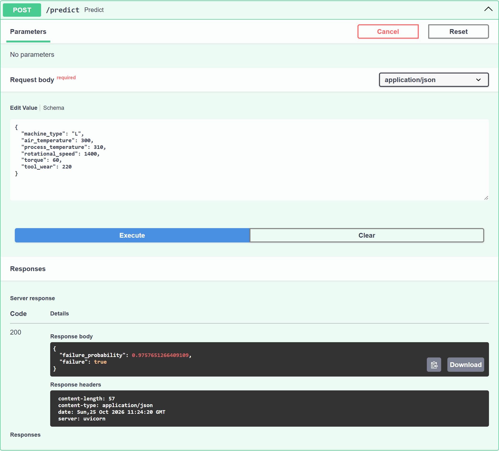

# AI4I Machine-Failure Predictor

[](https://github.com/Doskipo/machine-failure-AI4I/actions/workflows/tests.yml)

A containerised FastAPI service that takes one machine's sensor reading and returns the probability it is about to fail, using a scikit-learn model trained on the [AI4I 2020 predictive-maintenance dataset](https://archive.ics.uci.edu/dataset/601/ai4i+2020+predictive+maintenance+dataset).

## Run it

Requires Docker. From the repo root:

```bash
docker build -t ai4i .
docker run -d --rm --name ai4i -p 8000:8000 ai4i && sleep 5   # app needs ~4 s to load the model
curl -X POST http://localhost:8000/predict -H "Content-Type: application/json" -d '{"machine_type":"L","air_temperature":300,"process_temperature":310,"rotational_speed":1400,"torque":60,"tool_wear":220}'
# {"failure_probability":0.9757651266409109,"failure":true}
```

Health check: `curl http://localhost:8000/health`. Interactive docs: http://localhost:8000/docs. Stop with `docker stop ai4i`.

On Windows, run the commands in Git Bash or WSL, or send the request from the `/docs` page.



## Input validation

Requests are validated with Pydantic before they reach the model. A bad request gets **HTTP 422** with a message saying which field failed. Bad inputs include a wrong type, a missing field, `machine_type` not in `L`/`M`/`H`, or a value outside physical limits (for example a temperature in Celsius instead of Kelvin). The limits are wider than the training range, so unusual but real readings still go through.

| Field | Unit | Allowed |
|---|---|---|
| `machine_type` | — | `L`, `M`, `H` |
| `air_temperature` | K | 273–320 |
| `process_temperature` | K | 283–330 |
| `rotational_speed` | rpm | 500–4000 |
| `torque` | Nm | 0–100 |
| `tool_wear` | min | 0–500 |

## Model and honest numbers

The model is logistic regression (`class_weight="balanced"`) behind one-hot encoding and scaling, saved as a single sklearn `Pipeline`, so serving uses exactly the preprocessing used in training. The failure-mode columns (TWF, HDF, PWF, OSF, RNF) are excluded because they are only known *after* a failure, and the target is their OR, so including them would leak the answer.

Held-out test set: stratified 20%, 2,000 rows, 68 failures (3.4%).

| Failure class | Value |
|---|---|
| **Recall** | **82.4%**: catches 56 of 68 failures |
| **Precision** | **14.2%**: 395 alerts, 339 of them false alarms |
| ROC AUC / PR AUC | 0.91 / 0.38 |

The model favours recall: it misses few failures but raises many false alarms. It's a baseline. A tree-based model and a tuned decision threshold are the obvious next improvements.

## Develop

```bash
uv sync               # install deps (incl. pytest)
uv run python train.py  # re-download data, retrain, overwrite model.joblib
uv run pytest         # API tests: health, prediction, 422 cases
```

## Next

- [x] Tests in CI: GitHub Actions runs pytest on every push and PR
- [ ] Docker build in CI, pushing the image to GHCR
- [ ] Deploy to an Azure endpoint (Thu 29 Oct)
- [ ] Drift monitoring: compare live input distributions against the training ranges
